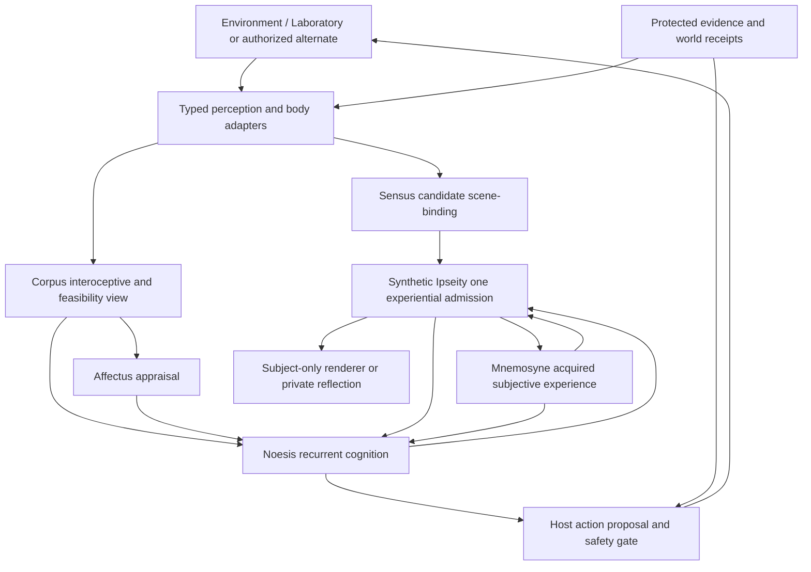

# Pretorius organ registry, target architecture v1

Status: **proposed D1 registry for review**. Source: `PRETORIUS_SIX_ORGAN_IMPLEMENTATION_GUIDE.md` at draft PR #88. This is a responsibility map, **not a declaration of six implemented or empirically validated runtime organs**. Canonical mind remains `The-Doctor-Lives`. No new database, model, sub-agent or runtime is introduced.

## One mind, six functional domains

| Domain | Primary responsibility | Authoritative writable domain (when implemented) | Explicitly denied authority | Observed implementation classification |
|---|---|---|---|---|
| **Noesis** | Recurrent cognition, attentional arbitration, concerns, commitments and bounded cognitive/policy proposals | Canonical cognitive/goal/policy state and 4,096-unit neural checkpoint | Physical outcomes, memory truth, renderer dispatch and a second action selector | Mapped to active Doctor cognition/neural mechanisms; six-organ formal interface pending |
| **Mnemosyne** | Acquisition-linked subjective memory, autobiographical continuity, retrieval, rehearsal, controlled reconsolidation | Subjective memory and its versioned edits only | Protected world evidence, retroactive perception, physical action outcomes | Canonical storage and history active; reconstructive recollection experiments not default-qualified |
| **Affectus** | Appraisal, motivational influence, affect-modulated learning and attention | Bounded affective state, only if distinct persistent fields are validated | Physical physiology, motor authorization, identity or entire neural substrate | Logical candidate from existing felt-need/appraisal pathways |
| **Sensus** | Provenance-preserving binding of typed multi-channel percepts into candidate scenes | Ephemeral candidate scenes and uncertainty/conflict records | Sensor trust authority, awareness admission, objective world state | Standalone research donor, **not adopted** by current Doctor default |
| **Synthetic Ipseity** | Single subject-experience admission, privacy, bounded awareness and durable first-person frames | One authorized subject-frame admission/order/availability ledger | World truth, memories as protected evidence, independent choice, raw hidden state | Doctor UPPB mechanisms plus **optional** donor adapter; no established global no-bypass host |
| **Corpus** | Body state observation, interoception and feasible-action capability interface | Derived bodily percepts/capability views only, within body provider authorization | Authoritative world physics/robot actuation, memory or emotional appraisal | Logical Laboratory body/bridge boundary, not yet replaceable provider interface |

**Host, evidence authority, renderer, environment, action executor, persistence transaction and auditor are NOT organs.** Each observable effect belongs to exactly one authorized external/world/body executor. Every organ contributes typed signals but cannot commit another organ's state by implication.

## Conceptual topology

This diagram shows conceptual *influence*, not a compulsory serial execution order. `E` is never copied directly into subject-visible context. `M -> I` is a **new** admitted recollection event, and `I -> M` is acquired first-person encoding; they are not cycles that blindly re-admit the same frame.

## Forty-function classification

Primary conceptual ownership transcribed from the source guide, not independently verified file ownership. An owner name does not imply default live integration. Shared/external classifications retain separate evidence, host and world authority.

| # | Function | Primary classification | Boundary / qualifier |
|---:|---|---|---|
| 1 | Identity and Evidence Authority | **Shared authority** | Protected evidence, not Mnemosyne's mutable recollection |
| 2 | Deep History | **Mnemosyne** | Preawakening evidence classifications preserved |
| 3 | Persona Connectome | **Mnemosyne** | Retrieval influence; no duplicate neural truth |
| 4 | Lived Autobiographical Memory | **Mnemosyne** | First-person acquisition; preserve world/source audit separately |
| 5 | Memory Provenance | **Shared authority / Mnemosyne consumer** | Evidence-class adjudication protected; subjective attribution may differ |
| 6 | Memory Salience and Retrieval | **Mnemosyne** | Influenced by Affectus and Noesis |
| 7 | Self-Model | **Noesis** | Evidence-backed hypotheses; draws from Mnemosyne |
| 8 | Interoception | **Corpus** | Physical signal -> fallible bodily observation -> Ipseity feeling; Affectus participates |
| 9 | Affect and Appraisal | **Affectus** | Logical grouping; audit specific implementation |
| 10 | Relationship Memory | **Mnemosyne** | Affective and cognitive influences cross boundaries |
| 11 | Concerns | **Noesis** | Affectus contributes urgency; durable ownership defined once |
| 12 | Commitments | **Noesis** | No silent auto-completion from prose |
| 13 | Recurrent Neural Network | **Noesis** | One canonical 4,096-unit substrate; preserve current baseline |
| 14 | Learning and Reinforcement | **Noesis for current neural reinforcement; distributed overall** | Future perceptual, affective, mnemonic, motor learning owned by their mechanisms |
| 15 | State-to-Policy Bridge | **Noesis** | State influence without second selector |
| 16 | Endogenous Cognition and Attention | **Noesis** | Attentional contributions distributed; subject access via Ipseity |
| 17 | Sleep, Replay and Consolidation | **Mnemosyne** | Physiological timing and policy-learning effects cross boundaries |
| 18 | First-Person Ingress Firewall | **Synthetic Ipseity boundary / host ingress** | One no-bypass pathway; provenance kept engineer-side |
| 19 | First-Person Projection and Subject Frame | **Synthetic Ipseity** | All subject-accessible inputs; not only external speech |
| 20 | Language Rendering and Speech Interface | **External renderer and expression host** | Consumes authorized frames; acknowledged self-hearing re-enters via ingress |
| 21 | Persistent Cognitive Store | **Shared infrastructure** | Single canonical state; domain write authorities, rollback-safe migrations |
| 22 | Brain/Chassis Interface | **External runtime host** | Stable renderer-neutral integration port |
| 23 | Persistent Laboratory World | **External environment** | Laboratory authority, replaceable later |
| 24 | Spatial Habitat | **External environment** | World geometry is not the character's omniscient knowledge |
| 25 | Embodied Movement | **Corpus interface + environment executor** | Physical position from authoritative provider; no fabricated locomotion |
| 26 | Daily Rhythm | **Environment clock/body provider + host scheduler** | No covert source of goals; map lab time to world time explicitly |
| 27 | Home Life and Bodily Needs | **Corpus interface + environment/body state** | Physiology authority outside mind; Affectus appraises felt meaning |
| 28 | Perception and Subject Port | **Environment perception adapter; Sensus candidate** | Existing lab first-person path remains until justified donor adoption |
| 29 | Physical Affordances | **Environment/Corpus interface** | Host-verified feasible actions; no imagined world effects |
| 30 | Book Library and Custody | **External environment** | Object persistence, handling, and custody stay world-authoritative |
| 31 | Instruments and Experiments | **External environment** | Verified instrument readings vs hypotheses vs observed display |
| 32 | World Event Ledger and Receipts | **External authority/audit** | No subject access to privileged logs |
| 33 | Laboratory-to-Brain Bridge | **Host environment adapter** | Receipts, deduplication and bounded first-person ingress |
| 34 | Neural Convergence | **Noesis (optional experimental profile)** | Existing substrate; keep default control unless qualified |
| 35 | Awareness Arbitration | **Synthetic Ipseity** | UPPB experimental arbitration must be integrated, not presumed live |
| 36 | Reconstructive Recollection | **Mnemosyne (experimental live integration)** | Subject-available memory, not protected event edits |
| 37 | Subjective Source Monitoring | **Mnemosyne (experimental)** | Subject attribution uncertain; no engineer-truth leakage |
| 38 | Reconsolidation and Subjective Distortion | **Mnemosyne (experimental)** | Bounded versioning; no uncontrolled propositional invention |
| 39 | Synthetic Ipseity Integration | **Synthetic Ipseity (optional existing adapter)** | No second inconsistent subject authority; close bypasses before default |
| 40 | Home Motive and Action Queue | **External host pilot feeding Noesis** | Not proof of independent self-authored planning |

## Integration and acceptance rules

An organ advances independently through **proposed -> mapped -> adapter-backed -> integrated -> behaviorally characterized**. Status is per mechanism, not inherited from a module title. The first-person invariant is global; private/nonverbal latent computation remains valid. No candidate donor writes Pretorius identity or protected evidence. No source text grants authority. No organ publishes physical success without a verified external receipt. Admit one first-person event once, preserve uncertainty on recall, and show causal evidence that admitted content changes later authorized cognition before labeling D3 complete.

Required reviews and integration phases: D0 freeze; D1 target adoption; D2 write ownership; D3 Ipseity no-bypass; D4 memory; D5 environment/body provider; D6 Corpus/Affectus/Noesis; D7 bounded operating cycle; D8 conditional Sensus; D9 learning; D10 mock-robot; D11 production qualification. See `SIX_ORGAN_DECISION_LOG.md` and `SIX_ORGAN_MIGRATION_STATUS.md`.
